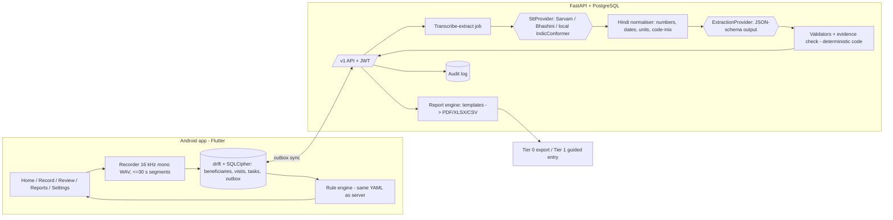

# A.U.R.A. — plan.md

> The build plan. Facts live in `context.md` (tags [V]/[U]/[D], sources [S#]). Session state lives in `handoff.md`.
> Plan version 2.0 — 2026-10-28. Replaces v1.0. Task IDs from v1.0 are kept; new IDs are marked *(new)*.
> Hard dates: **demo-ready 5 Nov** (D-12) · **SFIC submission window closes 6 Nov** [V][S2, live portal 28 Oct] · state screening from 7 Nov · showcase/finale window 30 Nov–15 Dec [V][S2].

---

## 0. The plan on one page

**What we are proving:** an ASHA can speak a visit note in Hindi, see a correct structured record with the words it came from, fix anything wrong in a few taps, confirm once, and get back (a) her next due visits and (b) a month-end sheet — in less time than typing, and without the app watching her.

**How we win the judging:** a live demo on a real phone + a reproducible evaluation report with our own numbers + an honest integration story (Integration Ladder) + a costed pilot design. Every claim traceable.

**The order of work (why it is this order):**
1. **Pipeline + measurement first** (days 1–5). It is the highest risk (R-01, R-02) and everything else is ordinary app work.
2. **Thin vertical slice on a phone** (days 5–8). Record → review/confirm → task list → one report. Ugly is fine; honest is mandatory.
3. **Submit on 5–6 Nov** with the demo video and concept note.
4. **Harden with evidence** (to 25 Nov): bigger dataset, bake-off, user sessions, offline/sync, privacy audit. Freeze numbers 25 Nov.
5. **Showcase prep** (26–29 Nov): deck with real numbers, rehearsals, Q&A.

**Phases at a glance**

| Phase | Dates (2026) | One-line goal | Gate |
|---|---|---|---|
| P0 Lock | 28–29 Oct | Decisions, repo, schema, first scripts, provider keys | **G-0** repo runs, schema tests pass, ≥1 STT provider callable |
| P1 Prove | 30 Oct–2 Nov | Voice → JSON pipeline + mini-eval (≥40 notes) + app skeleton | **G-A** end-to-end on laptop; first real numbers in `eval/results/` |
| P2 Slice + Submit | 3–6 Nov | Phone demo, rules, one report, demo video, SFIC package | **G-B (5 Nov)** speak → confirm → task + report on a real phone; **submitted by 6 Nov** |
| P3 Harden | 7–15 Nov | ≥120-note bake-off, interviews, offline/sync, settings/privacy, second report | **G-C** bake-off decision record; offline matrix passes |
| P4 Evidence | 16–25 Nov | Usability + time study, low-end device, security/privacy audit, eval freeze | **G-D (25 Nov)** `eval/results/final/` frozen; audits clean |
| P5 Showcase | 26–29 Nov (+ window from 30 Nov) | Deck, video v2, rehearsals, Q&A, pilot one-pager | **G-E** two full rehearsals; every number traced |

**Cut order if late** (from first cut to last): guided-entry cards → sync polish → second report → Settings detail → TTS read-back. **Never cut:** review/confirm screen, evidence check, the eval report, the privacy contract.

---

## 1. Reality check (carried from v1.0, updated)

1. **No POC exists.** Numbers come only from `eval/results/`. The POC slide stays blank until G-A.
2. **The 16% statistic is not defensible** (2007 West Bengal ANM study) → removed; replaced by our time study (T-011).
3. **No verified API path to RCH/ANMOL/e-Kavach/BCPM-MIS.** ABDM is a record-exchange network (6–9 months to certify), not a reporting pipe → Integration Ladder (§7).
4. **Hindi primary, English second** (D-01). Tamil dropped.
5. **Scope was ~3× capacity** → one vertical slice by 5 Nov, then evidence.
6. **No direct UP user access** → ≥5 conversations (E1), with honest disclosure of who they were.
7. **Competitors exist** — ASHABot, KhushiHealth, AMRIT FLW (which already has *voice entry* for some fields), Wadhwani HealthVaani, and hobby "voice-to-form" builds [V][S20][S21][S29]. "Nobody does this" is false. Our gap: **voice → evidence-backed verified record → reused across several outputs, under a worker-first privacy contract**, measured in the open.
8. **Hindi ASR is good but not perfect.** 2026 Hindi spontaneous-speech benchmark: best systems ~10.6–13.7% WER; rankings change across datasets [V][S30]. Rural UP field audio will be worse. → The review step is the product.
9. **UP already digitised incentive payments (BCPM-MIS)** → we make *claim support sheets*, not claims.
10. **Unverified background claims** (2026 strike, Kerala numbers) → cite or drop (T-014).
11. **SFIC window closes 6 Nov** per the live portal (older copies said 24 Oct). Our nomination/entry status still needs a human check in the portal (T-001).

---

## 2. Goals and success metrics

Targets are **proposals**; they are locked after G-A (first real numbers) and may move — but only with a logged decision.

| ID | Goal | Metric | Proposed target | Measured by |
|---|---|---|---|---|
| G1 | Voice → correct structured record | Field-level F1 before review on ≥100 Hindi notes; critical-field exact match (beneficiary, visit type, date, vitals, due dates); **hallucination rate** (non-null field with no supporting speech) | F1 ≥ 0.85; critical ≥ 0.90; hallucination ≤ 2% | `eval/` harness (T-025) |
| G2 | Net time saved | Median time to finish a visit record: speak + review vs typing the same fields | ≥ 50% reduction, n ≥ 5 | Stopwatch study (T-011, T-063) |
| G3 | Reports correct | Monthly summary + claim support sheet vs hand-computed oracle on a synthetic month | 100% match; < 10 s | Oracle tests (T-054) |
| G4 | Works offline | Core flows in airplane mode; zero data loss across 200 offline→online cycles | 100% | T-061 |
| G5 | Privacy contract holds | Manifest + code + network inventory: no location/contacts/call log/SMS | 0 violations | T-060 |
| G6 | Usable by target users | Task success + SUS-lite on ≥5 users incl. ≥2 low-literacy proxies | ≥ 80% task success | T-063 |
| G7 | Cost credible | ₹/ASHA/month (STT + LLM + hosting), assumptions stated | Published | T-072 |
| G8 *(new)* | Latency acceptable | Stop-recording → review screen ready, p50 / p95 on 4G-like link | p50 ≤ 6 s, p95 ≤ 15 s | Eval harness timing (T-025) |

Principle: **net-time-positive or don't ship.**

---

## 3. Scope (MoSCoW)

### Must (demo-critical, by 5 Nov unless marked P3)
- **M1 Capture:** record Hindi visit note (≤30 s segments, auto-split), offline queue, transcribe + extract, **review & confirm** with evidence highlights, save locally.
- **M2 Visit types:** HBNC, HBYC, immunisation follow-up, ANC, "other". ANC tasks hidden until ANC rules are verified (T-013).
- **M3 Home:** today's task list from the rule engine (HBNC + HBYC + UIP), each with "why now"; actions: open, record, reschedule, dismiss.
- **M4 Reports:** incentive **claim support** sheet (5 Nov) and monthly activity summary (P3); PDF + XLSX.
- **M5 Local-first + sync:** local DB on phone; outbox sync (minimal by 5 Nov, hardened in P3).
- **M6 Settings:** language, state, ASHA ID, privacy panel (what is stored, export, delete), help. Minimal by 5 Nov, full in P3.
- **M7 Evaluation harness + dataset** — this is the evidence.
- **M8 Auth:** phone-OTP (mock provider, labelled) + ASHA ID in profile (D-03).

### Should
Text-input fallback (same review flow) · TTS read-back of the confirmed summary · Tier-1 guided-entry cards (e-Kavach/U-WIN) · audit log of edits + edit-distance metric · "guided voice" mode (short fixed prompts per field) as the fallback if free speech scores poorly (R-01).

### Could
On-device STT (sherpa-onnx) · ANM read-only view · ward grouping for day planning (no GPS) · ABHA verification stub.

### Won't (this phase — say so openly)
Real government API integration; ABDM certification; Aadhaar/ABHA data; automated filling of government apps (JS/accessibility/scraping); real patient data; GPS, attendance, productivity scoring; ML clinical risk prediction (rules only).

---

## 4. Architecture



### 4.1 Key design decisions
- **Server holds every API key.** The phone never calls STT/LLM vendors.
- **Provider adapters** (`SttProvider`, `ExtractionProvider`) — swap on evidence, survive outages.
- **Deterministic code owns truth.** The LLM proposes; code parses numbers, resolves dates ("kal", "parso", "pichhle hafte") against the recording date, checks ranges, and checks that every evidence quote is a substring of the (normalised) transcript. Anything that fails is shown as "please check", never silently kept.
- **Hindi normaliser (new, important):** spoken numbers come as words ("एक सौ बीस", "do kilo aath sau gram"), Devanagari or Latin digits, and English code-mix ("BP 120 by 80", "Hb nau point paanch"). One tested module converts these to values *with the span they came from*. The LLM is asked for the quote; code derives the number from the quote.
- **Rules run on the phone and the server** from the same `rules/*.yaml` (tests generated from context §8), so tasks appear offline.
- **Offline (MVP):** audio is queued locally; transcription runs when online; offline review falls back to manual form entry. Fully offline voice is a Could.
- **Audio retention:** delete after confirmation, hard cap 7 days (D-07).
- **Hosting:** laptop server for the demo (D-06), reachable from the phone over local Wi-Fi or a tunnel; India-region cloud for the pilot. Synthetic data only, so cloud STT/LLM is acceptable now; production residency is an NHM question (§7.3).
- **App stack:** Flutter, Riverpod, drift + SQLCipher (`sqlcipher_flutter_libs`), `record` package for audio, ARB i18n (hi default, en). **Verify the recorder's real output sample rate on the test phone** — the package depends on OS settings and has open Android WAV issues [V][S33].
- **API:** `/v1/...`, UTC ISO-8601, device-generated UUIDs, idempotency key on every write.

### 4.2 Data model (v0)
`asha_profile` (id, asha_id, phone_hash, state, district, block, language) · `household` (id, label, ward_label) · `beneficiary` (id, household_id, name, sex, dob, category[pregnant|newborn|child|other], edd, delivery_date, delivery_place[institution|home], lbw, risk_flags[]) · `visit_event` (id, beneficiary_id, visit_type, visit_date, payload JSON §5.2, extracted_payload JSON, status[draft|confirmed], source[voice|text|manual], created_at, version) · `task` (id, beneficiary_id, rule_id, due_date, window_end, status[open|done|rescheduled|dismissed], priority, reason) · `outbox` (id, entity, op, payload, idempotency_key, attempts, next_try) · `report_run` (id, template_id, period, status, file_ref) · `audit_log` (id, actor, action, entity, before_hash, after_hash, at). All fixtures synthetic.

---

## 5. Voice → structured record pipeline (built and measured first)

### 5.1 Stages
1. **Capture** 16 kHz mono WAV; trim silence; auto-split at ≤30 s (Sarvam REST limit [V][S4]); gentle "next detail" prompt.
2. **STT** via adapter → transcript + per-segment confidence where available.
3. **Normalise** (code): numbers, units, dates, common code-mix tokens; keep a map from normalised text back to the raw span.
4. **Entity resolution:** match the spoken name to the ASHA's beneficiary list (Devanagari/Latin transliteration + phonetic + fuzzy); top match below threshold → ask her to pick.
5. **Extraction:** LLM with structured output against the schema → fields **plus evidence quotes**.
6. **Validation** (code): schema, ranges, cross-field (e.g. HBNC day vs delivery date), evidence substring check, date resolution.
7. **Review & confirm UI:** each field shows value + quote; failed/low-confidence fields are highlighted first; tap to fix; one confirm.
8. **Learning loop (post-MVP):** store extracted vs confirmed diffs (no audio) to find weak fields.

### 5.2 Extraction schema v0.1 (draft; ANM/clinician review pending)
```json
{
  "schema_version": "0.1",
  "visit_type": "ANC|PNC|HBNC|HBYC|IMMUNIZATION|FAMILY_PLANNING|TB_FOLLOWUP|NCD_FOLLOWUP|OTHER",
  "visit_date": "YYYY-MM-DD|null",
  "beneficiary": {"mention": "string", "matched_id": "uuid|null", "match_confidence": 0.0},
  "visit_index": {"anc_number": "int|null", "hbnc_day": "int|null", "hbyc_month": "int|null"},
  "vitals": {"weight_kg": "num|null", "temp_c": "num|null", "bp_sys": "int|null", "bp_dia": "int|null", "hb_g_dl": "num|null", "pulse": "int|null", "resp_rate": "int|null"},
  "danger_signs": [{"code": "string", "present": "bool|null"}],
  "services_given": [{"type": "IFA|CALCIUM|VACCINE|ORS|ZINC|COUNSELLING|OTHER", "detail": "string|null"}],
  "referral": {"needed": "bool|null", "facility": "string|null", "reason": "string|null"},
  "next_due": [{"what": "string", "date": "YYYY-MM-DD|null"}],
  "note": "string|null",
  "evidence": {"<field.path>": {"quote": "exact transcript span", "confidence": 0.0}}
}
```
The schema accepts all visit types; the MVP UI and rules cover HBNC, HBYC, immunisation, ANC (tasks hidden) and OTHER. PNC/FP/TB/NCD extract into the record but have no tasks yet.

**Hard rules (enforced in code, each with a test):**
- Not said → `null`. Never inferred.
- Every non-null field has an `evidence.quote` that is found in the normalised transcript; otherwise the field is flagged and cleared to `null` pending review.
- Numeric values are re-derived from the quote by the normaliser; mismatch → flag.
- Draft ranges (to be reviewed): newborn weight 0.5–6 kg; temp 34–42 °C; Hb 3–20 g/dl; BP sys 60–260 / dia 30–160; pulse 40–220; resp 10–100.
- Relative dates resolved in code against the recording date.
- Danger signs use a fixed code list (from HBNC/HBYC job aids); unknown codes rejected.

### 5.3 Evaluation (build before the app screens)
- **Dataset:** 40 notes by 1 Nov (mini-eval) → ≥120 by 12 Nov. ≥100 Hindi + ≥20 English/code-mixed. Written from real form fields with ground-truth JSON. Spread: HBNC 35%, HBYC 20%, immunisation 20%, ANC 15%, other 10%. Include "hard" notes: two beneficiaries mentioned, corrections mid-sentence ("nahi nahi, 2.8 kilo"), numbers as words, nothing stated for most fields.
- **Recording:** ≥6 speakers (majority women's voices), three conditions (quiet room, household noise, outdoors), phone mic, read naturally; signed consent (T-004 template). Synthetic content only.
- **Systems in the bake-off:**
  - STT: Sarvam Saaras (current version) [S4]; Bhashini/Dhruva ASR [S7]; self-hosted IndicConformer-600M multilingual (MIT, gated HF download) on the local GPU [V][S6][S31]; IndicWhisper [S8].
  - Extraction: a frontier model (upper bound), a small fast model, Sarvam's LLM, and one open-weight 7–14B model on the local GPU. Candidate Claude models: `claude-haiku-5-5` ($0.10/$0.50 per M tokens), `claude-sonnet-5-5` ($2/$10), `claude-opus-5-5` ($4/$20) with structured output (`output_config.format`) [V][S32].
  - Baseline: single-pass audio → JSON with an audio-capable model (if available within budget).
- **Metrics:** WER and CER after a fixed Hindi normalisation (script, nukta, punctuation — WER otherwise over-penalises valid variants [V][S30]); field precision/recall/F1; critical-field exact match; hallucination rate; review edit distance; latency p50/p95; ₹ per note.
- **Output:** `eval/results/<date>/report.md` + raw JSON; decision record `docs/decisions/00x-stt-llm-defaults.md` (T-026). Re-run on every model/prompt change. **Freeze 25 Nov** (T-065).
- **Honesty rule:** a scripted-read dataset is easier than real visits. Every slide says "scripted synthetic notes read by n volunteers" next to the number.

---

## 6. Rules and reports

### 6.1 Rule engine (`rules/*.yaml`)
Each rule: `id`, `programme`, `trigger` (e.g. delivery_date + place), `due` (offset days/months), `window`, `conditions`, `priority`, `reason_text_hi/en`, `source` [S#], `status: draft|clinician_reviewed`. Unreviewed rules show an "advisory — not yet reviewed" label.
- **HBNC:** institutional delivery → days 3, 7, 14, 21, 28, 42; home delivery adds day 1 [V][S16].
- **HBYC:** months 3, 6, 9, 12, 15 [V][S16].
- **UIP infant schedule:** context §8.3 table, 4-week minimum interval, no restart after a missed dose [V][S18].
- **ANC:** minimum 4 ANC visits + PMSMA specialist check on the 9th of the month; up to 3 extra follow-ups for high-risk pregnancies under extended PMSMA [V][S34]. Visit-by-visit timing still to be confirmed against the MoHFW maternal-health guideline → ANC tasks hidden until T-013.
- **Priority ("why now")**: overdue > due today > danger sign recorded > due this week; text explains which rule fired.

### 6.2 Report templates (`templates/UP/*.yaml`)
- **Incentive claim support sheet** (5 Nov): completed claimable activities this month (HBNC series, HBYC visits, immunisation mobilisation, monthly lists), with dates and status *ready / missing visit / missing condition*. Rates are config, labelled "national rates — confirm UP rates" until UP figures are obtained [S17][U7]. Verification and payment stay with ANM/Sangini and BCPM-MIS.
- **Monthly activity summary** (P3): counts by programme in an HMIS-like layout; real UP layout replaces it once the blank form is in hand (T-005).
- Exporters: PDF (printable, Hindi font embedded) and XLSX.

---

## 7. Integration Ladder (replaces "sync everywhere")

| Tier | What it is | Status | Notes |
|---|---|---|---|
| **0 Export** | PDF/XLSX/CSV in the shape of the target register/claim/report | **Real** | Needs blank official formats (T-005). |
| **1 Guided entry** | Field-by-field cards in the target app's form order; one-tap copy; progress ticks; no automation, no credentials | **Real (Should)** | Zero integration risk. |
| **2 Official API** | NHM/state-approved integration (Co-WIN had protected third-party APIs [S24]) | **SIMULATED, labelled** | Only through an NHM partnership. |
| **3 ABDM** | ABHA verification (M1) then M2/M3 if ever needed | **Roadmap** | 6–9 months + security audit [S10]. |

**Do not build:** JS injection, scraping, or storage of government credentials. Autofill is allowed under the conditions in `docs/decisions/003-autofill.md` (D-34, 2026-11-16).

### 7.1 Questions for UP NHM / PMU (T-012)
1. Which apps accept partner data (API, bulk upload, CSV/Excel), under what approval and data-sharing agreement?
2. Is there a sanctioned way for ASHA-captured structured data to reach e-Kavach / BCPM-MIS / U-WIN?
3. Current UP incentive rates, claim form, BCPM-MIS claim steps.
4. Official blank formats (VHR, HBNC formats 1–3, ASHA diary, monthly report).
5. Data fiduciary for a worker-side app; hosting/residency requirements.
6. Would NHM (or a partner NGO) host a 10-ASHA, 4-week pilot?

---

## 8. User research and validation (E1)

- **≥5 conversations** with ASHAs/ANMs/Sanginis by 12 Nov (phone fine). Routes, in order: NGO partners working with ASHAs; college community-medicine/outreach contacts; Tamil Nadu ASHAs near Chennai as proxies (state the limitation).
- **Guide (30 min):** typical day; which apps/registers, in what order; when she writes; voice-note habits; what is copied across apps; monthly claim steps and time; phone model/RAM/data; what would make her distrust an app; reaction to a 20-second demo.
- **Collect:** photos of *blank* forms only. Never patient data.
- **Time baseline (T-011):** ≥5 people type a given visit into a form vs speak + review. Use the same 5 visit cards for both; randomise order.
- **Ethics:** informed consent, record only with permission, no real names, share findings back.

---

## 9. Detailed schedule

### P0 Lock — 28–29 Oct
| Day | Builder (lead + Claude Code) | Team |
|---|---|---|
| Tue 28 | Plan v2 (this file) ✔; decisions locked ✔; T-003 repo scaffold starts | T-001 portal check; request Sarvam + Bhashini keys (B2); accept IndicConformer HF terms |
| Wed 29 | T-003 done (Makefile, CI, lint, secret scan); **T-020 schema + validators + normaliser v0 + tests**; STT adapter for the first provider with a key | T-021 write first 40 scripts + ground truth (template given); T-004 consent form; start T-005 forms + T-010 outreach |

**G-0:** `make setup && make test` green on a clean clone; schema tests pass; one STT call works on a sample file.

### P1 Prove — 30 Oct–2 Nov
| Day | Builder | Team |
|---|---|---|
| Thu 30 | T-023 second + third STT adapters (incl. local IndicConformer); T-024 extraction service | T-022 record the 40 scripts (≥4 speakers, 2 conditions) |
| Fri 31 | T-025 eval harness + report; T-027 name resolution v0 | Check transcripts by ear; fix ground truth |
| Sat 1 | **Mini-eval run #1** (3 STT × 2 LLM on 40 notes) → `eval/results/2026-11-01/`; T-040 Flutter skeleton | T-014 deck claim check; Hindi copy for screens |
| Sun 2 | Prompt/normaliser fixes; T-043 record UI; T-044 review screen v0 (against server) | Write the next 40 scripts |

**G-A:** a note recorded on a laptop goes through STT → extraction → validation and shows on a review screen; mini-eval report exists with real numbers, good or bad. **If G1 is far off** (e.g. critical-field match < 0.7): switch on guided-voice mode (Should) for the demo and say so.

### P2 Slice + Submit — 3–6 Nov
| Day | Builder | Team |
|---|---|---|
| Mon 3 | T-050 rule engine (HBNC/HBYC/UIP) + table tests; T-046 Home task list; T-041 local DB | Demo story script (T-071): one synthetic household, 3 visits |
| Tue 4 | T-054/T-055 claim support sheet + PDF/XLSX export; T-042 mock OTP; T-047 minimal sync; run on a real phone | SFIC concept note draft (T-073); record demo video takes |
| Wed 5 | Bug fixes only; mini-eval run #2; freeze demo build | **G-B dry run** ×2; final 2-min video |
| Thu 6 | — | **Submit SFIC package** (concept note, video, eval summary, repo link if public) |

**G-B (5 Nov):** on a real Android phone: speak a Hindi visit note → review shows fields with quotes → fix one field → confirm → Home shows the next HBNC/HBYC due visit with "why now" → claim support sheet exports as PDF. All simulated parts labelled.

### P3 Harden — 7–15 Nov
T-021/T-022 grow dataset to ≥120 notes, ≥6 speakers, 3 conditions · T-026 full bake-off + decision record · T-028 audio→JSON baseline · T-010 interviews (≥5 by 12 Nov) · T-012 NHM email sent · T-031/T-047 sync hardening + T-061 offline matrix · T-045 beneficiary registry · T-049 Settings + privacy panel (export/delete) · T-053 monthly summary · T-04B text fallback · T-033 audit log + PII-free logging · T-056 guided-entry cards (if on time).
**G-C:** bake-off decision record with numbers; offline matrix green; ≥3 interviews logged.

### P4 Evidence — 16–25 Nov
T-011/T-063 time study + usability (≥5 users, ≥2 low-literacy proxies) · T-062 low-end device (≤3 GB RAM) · T-060 privacy audit · T-064 security checklist · T-072 unit economics · T-013 rules review by ANM/clinician · T-065 **final eval freeze 25 Nov**.
**G-D:** `eval/results/final/` frozen; privacy and security reports in `docs/`; time-study numbers recorded with n.

### P5 Showcase — 26–29 Nov (window from 30 Nov)
T-070 deck with real numbers only · T-071 demo script v2 + offline fallback video · T-074 15 hard Q&As rehearsed · pilot one-pager (§12) · two full rehearsals with a timer.
**G-E:** every number on every slide has a file in `eval/results/` or an [S#].

---

## 10. Backlog (task IDs are referenced everywhere)

Status lives in `handoff.md`. Effort: S ≤ ½ day, M ≤ 2 days, L > 2 days. **Ph** = phase.

### E0 Setup and governance
| ID | Task | Done when | Eff | Ph |
|---|---|---|---|---|
| T-001 | Confirm SFIC entry status, deadline (portal says 6 Nov), required artifacts | Note in handoff | S | P0 |
| T-002 | Lock decisions; skills matrix | Decision log filled ✔ (skills matrix pending) | S | P0 |
| T-003 | Monorepo scaffold, CI (lint + test), secret scan, `.env.example`, Makefile | `make setup && make test` pass on clean clone | M | P0 |
| T-004 | Data-handling policy + volunteer consent form in `docs/` | Reviewed by lead | S | P0 |
| T-005 | Blank official forms (VHR, HBNC 1–3, diary, UP claim form) in `docs/forms/` | ≥4 forms or documented blockers | M | P0–P3 |
| T-006 *(new)* | Provider accounts: Sarvam key, Bhashini ULCA userID + key, HF access to IndicConformer, LLM API key | Keys in `.env`, terms read, notes in `docs/providers.md` | S | P0 |

### E1 Research validation
| ID | Task | Done when | Eff | Ph |
|---|---|---|---|---|
| T-010 | ≥5 ASHA/ANM/Sangini conversations | Notes in `docs/research/` | L | P0–P3 |
| T-011 | Time baseline study | n ≥ 5, median times recorded | M | P4 |
| T-012 | Email UP NHM/PMU (§7.1) | Sent; answers logged | S | P3 |
| T-013 | Verify ANC schedule, UP incentive rates, HMIS format; ANM/clinician review of rules | Rules status updated or flagged | M | P3–P4 |
| T-014 | Source-check every deck claim | All [V] or removed | S | P1 |

### E2 Pipeline (build first)
| ID | Task | Done when | Eff | Ph |
|---|---|---|---|---|
| T-020 | Schema v0.1 + validators + tests | Tests pass | M | P0 |
| T-020a *(new)* | Hindi normaliser (number words, units, dates, code-mix) with span map | ≥100 table-driven tests pass | M | P0–P1 |
| T-021 | Scripts + ground-truth JSON (40 → ≥120) | Files in `eval/data/` | M | P0–P3 |
| T-022 | Record dataset (≥6 speakers, 3 conditions) + manifest | Audio + manifest | M | P1–P3 |
| T-023 | STT adapters (Sarvam, Bhashini, local IndicConformer, IndicWhisper) | Each transcribes sample; terms/limits/licences logged | L | P1 |
| T-024 | Extraction service: prompt, structured output, evidence check | §5.2 hard rules enforced by code + tests | M | P1 |
| T-025 | Eval harness + auto-report (WER/CER, F1, hallucination, latency, cost) | `make eval` writes `report.md` | M | P1 |
| T-026 | Full bake-off + decision record | Defaults chosen with numbers | M | P3 |
| T-027 | Beneficiary name resolution | ≥95% on synthetic names | M | P1–P3 |
| T-028 | Single-pass audio→JSON baseline | In bake-off table | S | P3 |

### E3 Backend
| ID | Task | Done when | Eff | Ph |
|---|---|---|---|---|
| T-030 | FastAPI skeleton, JWT, mock phone-OTP, Postgres + Alembic | Auth e2e test | M | P1–P2 |
| T-031 | Sync API (push/pull, idempotency, versions) | Replay-safe tests | M | P2–P3 |
| T-032 | `/v1/transcribe-extract` job, retries, audio-retention job | Job tests; audio deleted per policy | M | P1 |
| T-033 | Audit log, rate limits, PII-free logging | Log scan clean | S | P3 |
| T-034 | Report API | Endpoint tests | S | P2 |

### E4 App
| ID | Task | Done when | Eff | Ph |
|---|---|---|---|---|
| T-040 | Flutter skeleton, theme, nav, i18n (hi, en) | Runs on low-end emulator | M | P1 |
| T-041 | drift + SQLCipher, repos, migration tests | Encrypted at rest | M | P2 |
| T-042 | Mock-OTP login + profile | Works offline after first login | S | P2 |
| T-043 | Record UI, ≤30 s segments, offline queue | Airplane-mode recording queued | M | P1 |
| T-044 | Review & confirm screen with evidence + edit | Never auto-submits; flagged fields first | L | P1–P2 |
| T-045 | Beneficiary registry | CRUD + search | M | P3 |
| T-046 | Home tasks | Matches rule engine output | M | P2 |
| T-047 | Sync client (outbox, backoff, status) | G4 test passes | M | P2–P3 |
| T-048 | Reports UI (state → template → preview → export) | Exports open correctly | M | P2 |
| T-049 | Settings + privacy panel (stored data, export, delete) | Delete wipes local + server | M | P3 |
| T-04A | TTS read-back (Should) | Hindi read-back works | S | P3 |
| T-04B | Text-input fallback (Should) | Same review flow | S | P3 |
| T-04C *(new)* | Guided-voice mode (Should; R-01 fallback) | Field-by-field prompts feed the same review | S | P2 if G-A misses |

### E5 Rules and reports
| ID | Task | Done when | Eff | Ph |
|---|---|---|---|---|
| T-050 | Rule engine (YAML) + table tests: HBNC, HBYC, UIP (+ANC after T-013) | Tests from context §8 pass | M | P2 |
| T-051 | Explainable priority ("why now") | Each task shows its reason | S | P2 |
| T-052 | Template registry + mapping format | Two templates load | M | P2 |
| T-053 | Monthly activity summary | Matches oracle | M | P3 |
| T-054 | Claim support sheet + oracle tests | G3 pass | M | P2 |
| T-055 | Exporters PDF/XLSX/CSV (Hindi font) | Files validated | M | P2 |
| T-056 | Guided-entry cards e-Kavach/U-WIN (Should) | Order matches real forms | M | P3 |

### E6 Quality and trust
| ID | Task | Done when | Eff | Ph |
|---|---|---|---|---|
| T-060 | Privacy audit (manifest, code, network inventory) | G5 report | S | P4 |
| T-061 | Offline matrix + 200-cycle sync soak | G4 | M | P3 |
| T-062 | Low-end device test (≤3 GB RAM, Android 8–12) | Usable, no crashes | S | P4 |
| T-063 | Usability test ≥5 users | G6 | M | P4 |
| T-064 | Security checklist | Signed | S | P4 |
| T-065 | Final eval run; freeze | `eval/results/final/` | S | P4 |

### E7 Pitch and demo
| ID | Task | Done when | Eff | Ph |
|---|---|---|---|---|
| T-070 | Deck with real numbers only | Every number has a file or [S#] | M | P5 |
| T-071 | Demo script + offline fallback video | Rehearsed twice | S | P2, P5 |
| T-072 | Unit economics + impact one-pager | Assumptions stated | S | P4 |
| T-073 | SFIC submission package | Submitted by 6 Nov | M | P2 |
| T-074 | Hard-question prep (§13) | 15 Q&As rehearsed | S | P5 |

---

## 11. Testing strategy
- **Golden tests** for extraction (fixture transcript → expected JSON) and **property tests** for validators and the normaliser.
- **Table-driven rule tests** from context §8 (every schedule row, incl. home vs institutional delivery).
- **Oracle tests** for reports (independent expected totals).
- **Offline/sync soak** (random disconnects, duplicate pushes, app kills).
- **Security:** secret scan in CI, encrypted DB, TLS, minimal permissions, dependency audit.
- **Human checks:** usability sessions, ANM/clinician review of rules, native-speaker Hindi copy review.
- **CI gates:** lint + unit tests on every push; eval runs on demand (`make eval`) because it costs money and needs audio.

---

## 12. Pilot design (credible pathway — Open-level criterion)

| Element | Proposal |
|---|---|
| Who | 10 ASHAs + 2 ANMs in one UP block or NGO-supported cluster, voluntary |
| Duration | 4 weeks after hardening; 1 week training on synthetic data first |
| What | Voice capture + review + claim support sheet; real data only under NHM approval and a data-sharing agreement |
| Measures | Time per record, evenings spent on monthly work, error rate after review, weekly active use, trust interviews |
| Safeguards | No location/attendance; opt-out anytime; delete on request; India-region hosting |
| Cost | Measured ₹/ASHA/month (STT + LLM + hosting) from T-072 |
| Risk | NHM permission → NGO partner and advisory (not official) status |

### 12.1 Unit-economics model (assumptions, to be replaced by measured values)
- Audio: 5 visits/day × 45 s × 26 days ≈ 1.6 h/month. STT at ₹30/hour [V][S5] → ≈ ₹49/ASHA/month.
- Extraction: assume ~2,000 input + ~500 output tokens per note ≈ 130 notes/month. At list prices [S32] that is about $0.06/ASHA/month on `claude-haiku-5-5` and about $2.3/ASHA/month on `claude-opus-5-5` (token counts are an assumption until T-025 measures them).
- Self-hosted IndicConformer or Bhashini cuts the STT line; the bake-off decides whether that costs accuracy.

---

## 13. Judging criteria → evidence → hard questions

| Criterion | Evidence we will show | Hard question to prepare for |
|---|---|---|
| Relevance | Documented burden, surveillance backlash, voice evidence | "Where did 16% come from?" → removed; here is our measurement. |
| Originality | Voice → evidence-backed verified record → multiple outputs; privacy contract | "How is this different from e-Kavach / AMRIT (which has voice entry) / ASHABot?" |
| Feasibility | Live demo; eval report; offline test | "What if dialect ASR fails?" → review step, validators, guided-voice fallback, measured error rates. |
| Cost | ₹/ASHA/month with assumptions | "Who pays?" → state NHM/PMU; pilot via NGO. |
| Impact | Time saved (measured, n stated), claim readiness | "Have real ASHAs used it?" → exact n of conversations and sessions. |
| Scalability | Language/state via config + templates; provider adapters | "Do you integrate with RCH?" → Tiers 0–1 real; Tier 2 needs NHM; we do not claim more. |
| Quality | Tests, privacy audit, clean demo | "Data protection law?" → DPDP-aligned design, synthetic data, processor role. |

---

## 14. Decisions

All D-01…D-12 are **confirmed** as of 28 Oct (see `handoff.md` §5 for the log). D-04/D-05 are delegated to the bake-off (T-026). New decisions get the next ID and a record in `docs/decisions/`.

---

## 15. Risk register

| ID | Risk | L | I | Mitigation | Trigger → action |
|---|---|---|---|---|---|
| R-01 | Hindi/dialect ASR too weak | M | H | Review UI, normaliser, domain vocabulary, bake-off, text fallback | Critical-field match < 0.7 at G-A → guided-voice mode (T-04C) |
| R-02 | LLM invents clinical values | M | H | Null-by-default, evidence substring check, values re-derived by code, human confirm | Hallucination > 2% → tighten prompt/schema, fewer fields |
| R-03 | No real-user access | H | H | NGOs, outreach, TN proxies; disclose n | < 3 conversations by 7 Nov → mentor network |
| R-04 | Scope creep | H | M | MoSCoW, cut order, decision log | New feature → logged decision |
| R-05 | Integration claim challenged | M | H | Ladder, SIMULATED labels, NHM questions | — |
| R-06 | Privacy/legal exposure | M | H | Synthetic data, privacy contract, processor role | Any real-data request → stop, get approval |
| R-07 | Connectivity gaps | H | M | Offline queue, manual fallback | — |
| R-08 | Vendor keys late / limits / outages | M | M | Local IndicConformer first if keys are late; adapters; recorded demo video | Key missing by 30 Oct → demo on local model |
| R-09 | Team capacity / mixed skills | H | M | Engineering with builder; content/evidence with team | Task slips > 2 days → reassign |
| R-10 | Clinical rule errors | M | H | Sourced YAML, review, "advisory" label | Unreviewed rule → labelled/hidden |
| R-11 | Deck credibility | M | H | T-014, T-070 | — |
| R-12 | SFIC timeline changes | M | M | Submit early (5–6 Nov); keep improving after | Date change → re-baseline |
| R-13 | Competitor overlap | M | M | Sharp positioning, published eval, privacy proof | — |
| R-14 | Low-end device performance | M | M | Test ≤3 GB RAM; no heavy on-device models in MVP | ANR → simplify |
| R-15 *(new)* | Recorder produces wrong sample rate/corrupt WAV on some Android phones | M | M | Verify on test phone day 1; server resamples; fallback AAC→WAV on server | Bad file → switch encoder |
| R-16 *(new)* | Scripted-read eval overstates real accuracy | H | M | Include hard/noisy notes; say "scripted" on slides; test spontaneous retellings | Judges ask → show hard-subset numbers |

---

## 16. Definition of done
- **Task:** acceptance in §10 met; tests written and passing; lint clean; no secrets/PII; `handoff.md` updated; SIMULATED labelled.
- **Phase gate:** criteria in §9 met with evidence files or test output.
- **Project:** G1–G8 measured and recorded; deck numbers traceable; privacy audit clean; submission delivered.
